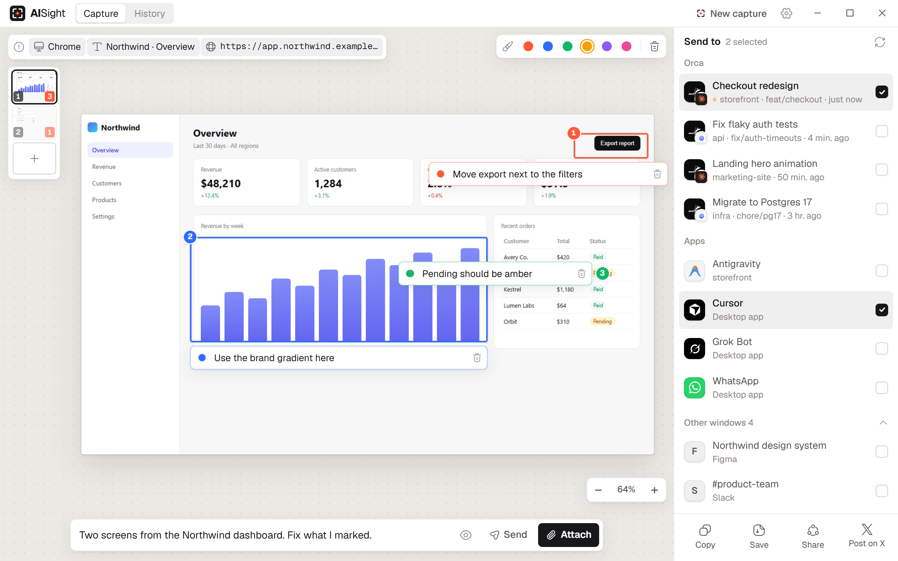
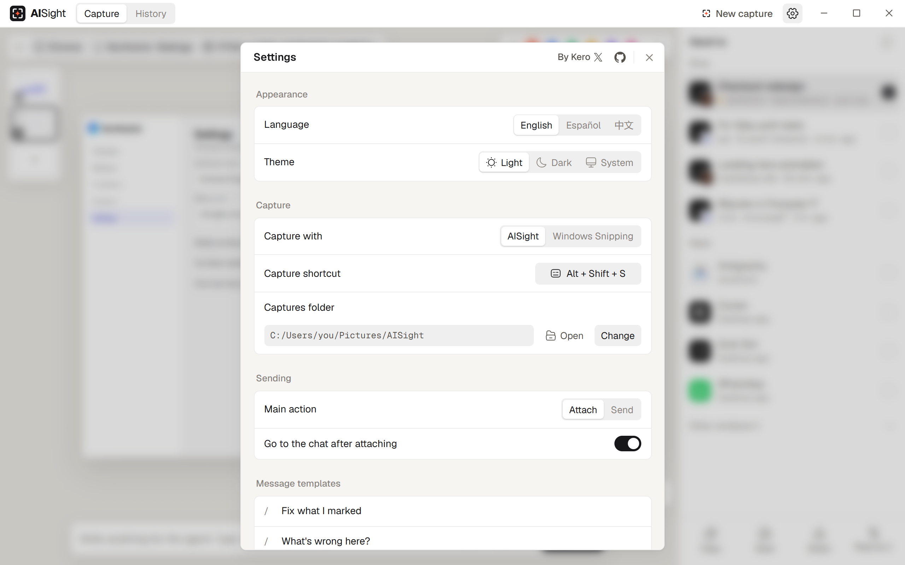
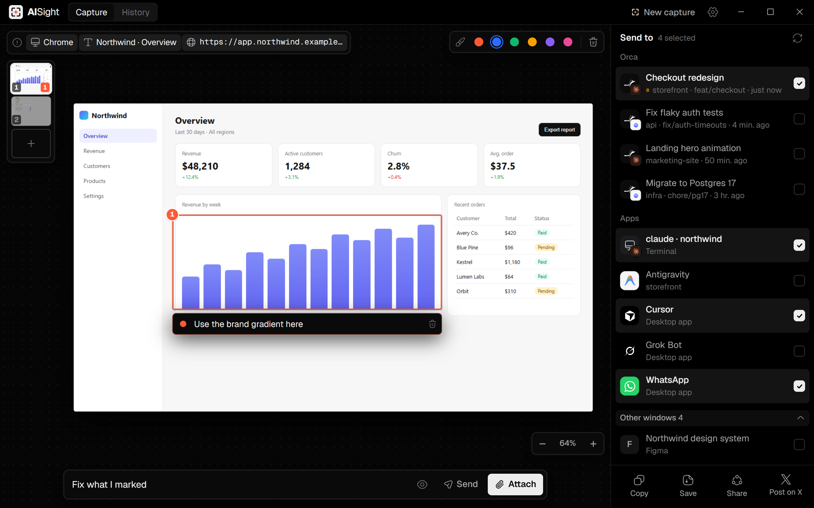

<div align="center">

# AISight

Screenshots straight into the chat of your AI agents.

<a href="https://x.com/uxKero"></a> <a href="LICENSE"></a> <a href="https://github.com/uxKero/aisight/releases/latest"></a>

<br><br>



</div>

<br>

Showing an agent what you see takes too many steps. Take the screenshot, find the right window, paste it, explain which part you mean, do it again for the next agent. AISight takes the capture, lets you mark what matters right on the image, and puts it in the chat of the agent you choose, already attached, with your note and where it came from. One capture can go to several agents at once. Everything runs on your computer.

## What is inside

- **Its own capture.** An area, a window or the full screen. Windows behind others and games included.
- **Marks on the image.** Click for a point, drag for a box, each with its own color and a note written right next to it.
- **Batches.** Several captures in one message, each with its own marks.
- **Where it came from.** The app, the window title and the browser URL travel with the capture, and each one turns off with a click.
- **Agents.** Orca sessions, Claude, Codex, Cursor, Antigravity, Grok, WhatsApp, and any other window with a chat.
- **Attach or send.** Leave it in the chat to keep writing, or send it right away. To one agent or several.
- **Quick options.** Type `/` in the message for templates, the text you copied, your last message or the image path.
- **Share.** Copy, save, the Windows share panel, or a post on X with the image already in it.
- **English, Spanish and Chinese,** light and dark.

## Capture

`Alt + Shift + S` freezes the screen. Drag an area, press `W` to pick a window, or `Enter` for the full screen. In window mode every open window shows up with a preview, the minimized ones too, and the one you pick is captured whole even if something covers it.

## Settings

Language, theme, the capture shortcut and folder, what Enter does, which details go with each capture and your message templates.



## Send to

Pick one agent or several. Orca sessions show their project and branch, and the agent running in them.



## How it reaches each agent

- **Orca** sessions get the capture through the Orca CLI, in the background, without moving your windows.
- **Apps** like Claude, Codex, Cursor, Antigravity, Grok Bot or WhatsApp get it pasted into their chat. The app comes to the front for a moment, and after sending you are back where you were.
- **Terminals** running Claude Code or Codex get the image path, which they attach on their own.

Before pasting into an app, AISight checks that the app is still in front. If anything took the focus, it pastes nothing and tells you.

## Install

Download the installer from [Releases](https://github.com/uxKero/aisight/releases/latest) and run it. AISight lives in the system tray. Captures are saved in `Pictures/AISight`.

## Develop

You need [Node.js 20+](https://nodejs.org), [pnpm](https://pnpm.io), [Rust](https://rustup.rs) and the Microsoft C++ Build Tools.

```bash
pnpm install
pnpm tauri dev     # the app with live reload
pnpm tauri build   # the installer, in src-tauri/target/release/bundle
```

`pnpm dev` alone opens the interface in the browser with example data.

Windows only for now.

<br>

<div align="center">

Made by [@uxKero](https://x.com/uxKero) under the [MIT License](LICENSE).

</div>
